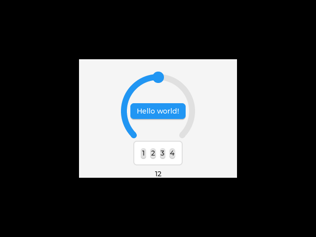
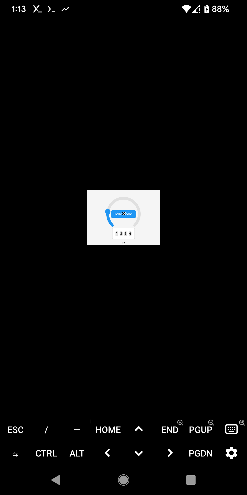
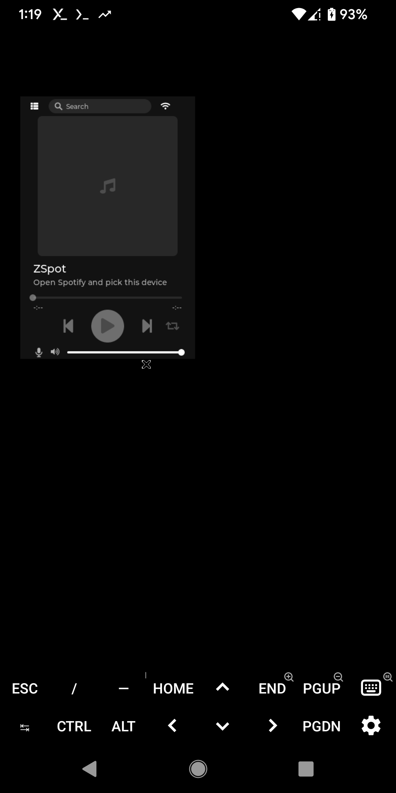

# Zephyr native_sim on a Google Pixel 3

Cross-compile a Zephyr `native_sim` application on a Linux laptop and run it on
a Pixel 3, using Termux and a Debian userspace on the phone. The phone needs no
root and no bootloader unlock.

```
Laptop (x86-64)                          Pixel 3 (aarch64, Android 12)
+-------------------------------+        +---------------------------------+
| Podman: Debian 13 container   |  scp   | Termux (bionic): sshd, port 8022|
|   aarch64 cross gcc           | -----> |   proot-distro                  |
|   -> zephyr.exe (aarch64)     |  ssh   |     Debian 13 (glibc)           |
+-------------------------------+        |       zephyr.exe runs here      |
                                         +---------------------------------+
```

`native_sim` builds Zephyr as an ordinary Linux program linked against glibc, so
nothing is flashed. Android uses the bionic C library and cannot run that
program directly, which is why the binary has to run inside Debian.

## Tested with

| Component | Version |
|---|---|
| Phone | Pixel 3 (`blueline`), Android 12 |
| Phone userspace | Termux, proot-distro 5.3.0, Debian 13 (glibc 2.41) |
| Laptop | Fedora 44, Podman |
| Zephyr | `v4.5.0-1406-gdecee24b4fb` |
| Cross compiler | `aarch64-linux-gnu-gcc` 14.2.0 (Debian 13) |
| Board target | `native_sim/native/64` |

## 1. Install Termux on the phone

1. Install Termux. The Google Play build (`googleplay.2026.10.09`) was used here.
2. Open Termux and install the packages:

   ```bash
   pkg update
   pkg install openssh proot-distro
   ```

   The SSH package is called `openssh` in Termux. `openssh-server` is the Debian
   name and doesn't exist here.

## 2. Start SSH in Termux

Run these in Termux on the phone:

```bash
passwd      # Termux has no default password
sshd        # listens on port 8022
whoami      # note the user name, for example u0_a381
```

`sshd` doesn't start by itself after a reboot, so run it again when needed.

Run SSH in Termux, not inside Debian, where it's harder to set up under proot.

## 3. Find the phone's IP address

Use **Settings > Network & internet > Wi-Fi**, then open the connected network.

Or, with USB debugging on (see [USB access](#usb-access-optional)):

```bash
adb shell ip -4 -o addr show wlan0
```

## 4. Connect from the laptop

Set these for your phone. The later commands use them:

```bash
PHONE=192.168.1.64
PHONE_USER=u0_a381
```

Copy your SSH key across, which asks for the password from step 2, and test it.
If you have no key yet, create one first with `ssh-keygen -t ed25519`.

```bash
ssh-copy-id -p 8022 "$PHONE_USER@$PHONE"
ssh -p 8022 "$PHONE_USER@$PHONE" 'whoami; uname -m'
```

The second command should print your Termux user name and `aarch64`.

## 5. Install Debian on the phone

```bash
ssh -p 8022 "$PHONE_USER@$PHONE" 'proot-distro install debian'
```

Debian's base system already has what the `hello_world` binary needs, which is
`libc` and `libm`.

## 6. Build the cross-compile image on the laptop

Do this once. Set `ZEPHYR` to your Zephyr tree, then run the rest from an empty
working directory:

```bash
ZEPHYR=$HOME/workspace/zephyrproject/zephyr

cp "$ZEPHYR/scripts/requirements-base.txt" .

cat > Containerfile <<'EOF'
FROM docker.io/library/debian:trixie
ENV DEBIAN_FRONTEND=noninteractive
RUN apt-get update && apt-get install -y --no-install-recommends \
      ca-certificates git cmake ninja-build gperf device-tree-compiler make file xz-utils \
      python3 python3-venv python3-pip \
      gcc-aarch64-linux-gnu g++-aarch64-linux-gnu libc6-dev-arm64-cross \
    && rm -rf /var/lib/apt/lists/*
COPY requirements-base.txt /tmp/
RUN python3 -m venv /opt/venv && /opt/venv/bin/pip install --no-cache-dir -r /tmp/requirements-base.txt
ENV PATH=/opt/venv/bin:$PATH
EOF

podman build -t zephyr-aarch64-cross -f Containerfile .
```

The image uses Debian 13 so that the binary links against the same glibc version
as the Debian on the phone. Podman runs rootless, so this needs no `sudo`.

## 7. Cross-compile hello_world

```bash
mkdir -p out

podman run --rm --security-opt label=disable \
  -v "$ZEPHYR":/zephyr:ro \
  -v "$PWD/out":/out \
  -e ZEPHYR_BASE=/zephyr -w /zephyr \
  zephyr-aarch64-cross bash -c '
    git config --global --add safe.directory /zephyr
    cmake -GNinja -S samples/hello_world -B /out/hello \
      -DBOARD=native_sim/native/64 \
      -DNATIVE_TARGET_HOST=aarch64 \
      -DZEPHYR_TOOLCHAIN_VARIANT=cross-compile \
      -DCROSS_COMPILE=/usr/bin/aarch64-linux-gnu-
    ninja -C /out/hello
  '

file out/hello/zephyr/zephyr.exe
```

`file` should report `ELF 64-bit LSB executable, ARM aarch64`.

Notes on the command:

- `/native/64` is required. Plain `native_sim` is a 32-bit target.
- The Zephyr tree is mounted read-only, so the build can't change it.
- `--security-opt label=disable` lets the container read the tree on an SELinux
  system. Don't use `:Z` on the mount, because it relabels your source tree.
- `cmake` and `ninja` are called directly, so the container doesn't need a west
  workspace. Modules such as LVGL aren't picked up automatically.

## 8. Run it on the phone

```bash
scp -P 8022 out/hello/zephyr/zephyr.exe "$PHONE_USER@$PHONE:hello-aarch64.exe"

ssh -p 8022 "$PHONE_USER@$PHONE" \
  'proot-distro login debian --bind $HOME/hello-aarch64.exe:/root/hello-aarch64.exe -- /root/hello-aarch64.exe --stop_at=1'
```

Expected output:

```
*** Booting Zephyr OS build v4.5.0-1406-gdecee24b4fbc ***
Hello World! native_sim/native/64

Stopped at 1.000s
```

`--stop_at=1` exits after 1 simulated second. Without it the program keeps
running until you press Ctrl+C.

To rebuild after a code change, repeat steps 7 and 8.

## USB access (optional)

Wi-Fi is enough for everything above. USB is useful for finding the IP address,
or if there's no shared Wi-Fi network.

1. Open **Settings > About phone** and tap **Build number** seven times.
2. In **Developer options**, turn on **USB debugging**.
3. Connect a data cable and unlock the phone.
4. Tap **Allow** on the **Allow USB debugging?** prompt.
5. Check that the status is `device`:

   ```bash
   adb devices -l
   ```

To tunnel SSH over USB, forward the port and connect to `localhost`:

```bash
adb forward tcp:8022 tcp:8022
ssh -p 8022 "$PHONE_USER@localhost"
```

A USB tunnel ends if the USB link drops, and every SSH session using it ends
too. Prefer Wi-Fi for long jobs.

## Troubleshooting

| Symptom | Cause | Fix |
|---|---|---|
| `adb: no devices/emulators found` | The phone isn't connected for data | Check `lsusb` for vendor `18d1`, then try a data cable and another port |
| `adb: device unauthorized` | The USB debugging prompt wasn't accepted | Unlock the phone. If there's no prompt, use **Revoke USB debugging authorizations** and reconnect |
| `Connection refused` on port 8022 | `sshd` isn't running, or the tunnel is missing | Run `sshd` in Termux, and `adb forward` if you're using USB |
| `Connection to localhost closed by remote host` | The USB tunnel dropped | Check `journalctl -k` for USB errors and use Wi-Fi instead |
| `xhci_hcd ... HC died; cleaning up` | The laptop's USB controller crashed. Seen on a Thunderbolt 3 controller | Use Wi-Fi or a port on another controller |
| `has unexpected e_type: 2` | The binary was run in Termux, outside Debian | Run it with `proot-distro login debian` as in step 8 |
| `ValueError: unsupported platform Android` | `west` is running on Termux's Python | See [Building on the phone](#building-on-the-phone-optional) |
| `Permission denied` on `ls /dev` in Debian | Expected under proot | Ignore it |
| `ls` or `stat` in Termux fails with `Function not implemented`, on any path | Termux's `ls` and `stat` use `statx`, which fails on this phone. The files are fine | Run them inside Debian, or use another tool such as Python's `os.listdir` |

## Building on the phone (optional)

Cross-compiling is the recommended flow. Building on the phone also works, but
the unpack and build took about 9 minutes and the tree needs about 565 MB.

Inside Debian, Termux's `bin` directory is on the end of `PATH`. Any tool missing
from Debian silently falls back to the Termux version. If `python3` comes from
Termux, it reports `android` and `west` fails. Remove Termux from `PATH` first,
and run long jobs with `nohup` and a log file so a dropped connection can't stop
them.

```bash
export PATH=/usr/local/sbin:/usr/local/bin:/usr/sbin:/usr/bin:/sbin:/bin

apt-get update
apt-get install -y --no-install-recommends ca-certificates git cmake ninja-build \
  gperf device-tree-compiler wget python3 python3-dev python3-pip python3-venv \
  xz-utils file make gcc g++ libc6-dev libmagic1

/usr/bin/python3 -c 'import sys; print(sys.platform)'    # must print: linux
/usr/bin/python3 -m venv ~/zephyr-venv
. ~/zephyr-venv/bin/activate
pip install west
```

Copying the tree from the laptop avoids a slow clone. It leaves out the git
history, so run this on the laptop:

```bash
git -C "$ZEPHYR" archive --format=tar.gz --prefix=zephyr/ HEAD > zephyr-src.tar.gz
scp -P 8022 zephyr-src.tar.gz "$PHONE_USER@$PHONE:"
```

Then, in Debian, with the archive bound in by logging in with
`proot-distro login debian --bind $HOME/zephyr-src.tar.gz:/root/zephyr-src.tar.gz`:

```bash
mkdir -p ~/zephyrproject && cd ~/zephyrproject
tar xzf /root/zephyr-src.tar.gz
west init -l zephyr
cd zephyr
pip install -r scripts/requirements-base.txt

export ZEPHYR_TOOLCHAIN_VARIANT=host
west build -p always -b native_sim/native/64 -o=-j4 samples/hello_world
./build/zephyr/zephyr.exe --stop_at=1
```

## LVGL sample on a virtual display

`samples/subsys/display/lvgl` cross-compiles and runs on the phone, drawing to
`Xvfb`, a virtual display inside Debian. `native_sim` draws through SDL, so the
build needs arm64 SDL and the phone needs the SDL runtime.



Add SDL to the image built in step 6:

```bash
mkdir -p sdl
cat > sdl/Containerfile <<'EOF'
FROM localhost/zephyr-aarch64-cross
RUN dpkg --add-architecture arm64 && apt-get update \
    && apt-get install -y --no-install-recommends pkg-config libsdl2-dev:arm64 \
    && rm -rf /var/lib/apt/lists/*
ENV PKG_CONFIG_LIBDIR=/usr/lib/aarch64-linux-gnu/pkgconfig:/usr/share/pkgconfig
EOF

podman build -t zephyr-aarch64-cross-sdl -f sdl/Containerfile sdl
```

Build the sample with the LVGL module. The module must be at the revision named
in Zephyr's `west.yml`:

```bash
LVGL=$HOME/workspace/zephyrproject/modules/lib/gui/lvgl

podman run --rm --security-opt label=disable \
  -v "$ZEPHYR":/zephyr:ro \
  -v "$LVGL":/lvgl:ro \
  -v "$PWD/out":/out \
  -e ZEPHYR_BASE=/zephyr -w /zephyr \
  zephyr-aarch64-cross-sdl bash -c '
    git config --global --add safe.directory /zephyr
    git config --global --add safe.directory /lvgl
    cmake -GNinja -S samples/subsys/display/lvgl -B /out/lvgl \
      -DBOARD=native_sim/native/64 \
      -DNATIVE_TARGET_HOST=aarch64 \
      -DZEPHYR_TOOLCHAIN_VARIANT=cross-compile \
      -DCROSS_COMPILE=/usr/bin/aarch64-linux-gnu- \
      -DZEPHYR_MODULES=/lvgl
    ninja -C /out/lvgl
  '

scp -P 8022 out/lvgl/zephyr/zephyr.exe "$PHONE_USER@$PHONE:lvgl.exe"
```

Then log in to Debian on the phone with
`proot-distro login debian --bind $HOME/lvgl.exe:/root/lvgl.exe` and run:

```bash
apt-get update
apt-get install -y --no-install-recommends libsdl2-2.0-0 xvfb x11-apps

Xvfb :1 -screen 0 640x480x24 -nolisten tcp -ac &
export DISPLAY=:1 SDL_VIDEODRIVER=x11 SDL_RENDER_DRIVER=software
/root/lvgl.exe --stop_at=30 &

sleep 15
xwd -root -silent -out /root/shot.xwd    # capture the display
```

`xwd` stores 3 bytes per pixel here, so check that when converting the file.
Reading it as 4 bytes per pixel produces false rainbow stripes.

The run also printed `error: expected absolute path: "--shm-helper"` twice. The
cause is unknown, and the sample still ran and drew correctly.

## LVGL on the phone's screen

To see the sample on the phone, use Termux:X11 instead of `Xvfb`. The window
appears inside the Termux:X11 app, not as a pop-up over other apps.



1. Install `termux-x11-universal-sharedUid-debug.apk` from the
   [termux-x11 releases](https://github.com/termux/termux-x11/releases).
2. In Termux, install the package and start the display:

   ```bash
   pkg install x11-repo
   pkg install termux-x11-nightly
   termux-x11 :0 &
   ```

3. Open the Termux:X11 app.
4. Back in Termux, enter Debian. `--shared-tmp` is required, because without it
   Debian can't see the display's socket:

   ```bash
   proot-distro login debian --shared-tmp --bind $HOME/lvgl.exe:/root/lvgl.exe
   ```

5. Run the sample, then switch to the Termux:X11 app:

   ```bash
   export DISPLAY=:0 SDL_VIDEODRIVER=x11 SDL_RENDER_DRIVER=software
   export LIBGL_DRI3_DISABLE=1 LIBGL_ALWAYS_SOFTWARE=1
   /root/lvgl.exe --stop_at=300
   ```

One of the two `LIBGL_` variables is required, either will do. Without them the sample hangs before
its window appears, using no CPU. Termux:X11 offers DRI3 and `Xvfb` runs without
this problem, so DRI3 under proot is the likely cause. Only the two variables
together were tested.

| Symptom | Cause | Fix |
|---|---|---|
| Sample runs but no window appears | `DISPLAY=:1` is `Xvfb`, which is invisible | Use `DISPLAY=:0` with Termux:X11 |
| `Error on SDL_Init (x11 not available)` | Debian can't reach the display | Log in with `--shared-tmp`, and check that `termux-x11 :0` is running |
| Black screen, sample stuck with no boot banner | The DRI3 hang above | Set a `LIBGL_` variable |
| `INSTALL_FAILED_SHARED_USER_INCOMPATIBLE` | A `sharedUid` build is already installed | Keep that build. It can't be replaced by the non-`sharedUid` APK |

## zspot on the phone's screen

[zspot](https://github.com/walidbadar/zspot) cross-compiles and runs on the
phone, with its UI in Termux:X11 and its zeroconf endpoint reachable over Wi-Fi.
Logging in and playing audio haven't been tested.



The stock `native_sim` build uses a TAP interface, but `/dev/net/tun` is denied
on an unrooted phone. This extra config uses Zephyr's offloaded sockets, which
need no root, and sends audio to a file because the phone has no `aplay`. The
zspot repository itself needs no changes.

```bash
ZSPOT=$HOME/workspace/firmware/zspot
MODULES=$HOME/workspace/zephyrproject/modules

mkdir -p zspot-img
cat > zspot-img/Containerfile <<'EOF'
FROM localhost/zephyr-aarch64-cross-sdl
RUN apt-get update && apt-get install -y --no-install-recommends protobuf-compiler \
    && rm -rf /var/lib/apt/lists/* \
    && /opt/venv/bin/pip install --no-cache-dir protobuf grpcio-tools
EOF
podman build -t zephyr-aarch64-cross-zspot -f zspot-img/Containerfile zspot-img

cat > phone.conf <<'EOF'
CONFIG_ETH_NATIVE_TAP=n
CONFIG_NET_L2_ETHERNET=n
CONFIG_NET_DRIVERS=y
CONFIG_NET_SOCKETS_OFFLOAD=y
CONFIG_NET_NATIVE_OFFLOADED_SOCKETS=y
CONFIG_ZSPOT_PCM_COMMAND=""
CONFIG_ZSPOT_SCREEN_TIMEOUT_SECONDS=0
EOF

podman run --rm --security-opt label=disable \
  -v "$ZEPHYR":/zephyr:ro -v "$ZSPOT":/zspot:ro \
  -v "$MODULES/lib/gui/lvgl":/m/lvgl:ro \
  -v "$MODULES/crypto/mbedtls":/m/mbedtls:ro \
  -v "$MODULES/crypto/tf-psa-crypto":/m/tf-psa-crypto:ro \
  -v "$MODULES/lib/nanopb":/m/nanopb:ro \
  -v "$PWD/out":/out -v "$PWD/phone.conf":/phone.conf:ro \
  -e ZEPHYR_BASE=/zephyr -w /zephyr \
  zephyr-aarch64-cross-zspot bash -c '
    git config --global --add safe.directory "*"
    cmake -GNinja -S /zspot/app -B /out/zspot \
      -DBOARD=native_sim/native/64 \
      -DNATIVE_TARGET_HOST=aarch64 \
      -DZEPHYR_TOOLCHAIN_VARIANT=cross-compile \
      -DCROSS_COMPILE=/usr/bin/aarch64-linux-gnu- \
      -DZEPHYR_MODULES="/m/lvgl;/m/mbedtls;/m/tf-psa-crypto;/m/nanopb" \
      -DEXTRA_CONF_FILE=/phone.conf
    ninja -C /out/zspot
  '

scp -P 8022 out/zspot/zephyr/zephyr.exe "$PHONE_USER@$PHONE:lvgl-run/zspot.exe"
```

With Termux:X11 running as in the previous section, log in to Debian with
`proot-distro login debian --shared-tmp --bind $HOME/lvgl-run:/mnt/run` and run:

```bash
export DISPLAY=:0 SDL_VIDEODRIVER=x11 SDL_RENDER_DRIVER=software
export LIBGL_DRI3_DISABLE=1 LIBGL_ALWAYS_SOFTWARE=1
cd /mnt/run
./zspot.exe --stop_at=600
```

Check the endpoint from the laptop:

```bash
curl "http://$PHONE:8080/spotify_info?action=getInfo"
```

`CONFIG_ZSPOT_SCREEN_TIMEOUT_SECONDS=0` matters here. With the default of 60 the
window turns black after a minute without a touch, which looks like it has gone.

zspot's own mDNS wasn't visible from the laptop, so advertise it from the laptop
with Avahi. This points the name at the phone, so no bridge is needed:

```bash
avahi-publish -a -R zspot.local "$PHONE" &
avahi-publish -s -H zspot.local ZSpot _spotify-connect._tcp 8080 \
  VERSION=1.0 CPath=/spotify_info Stack=SP &

avahi-browse -rt _spotify-connect._tcp    # check
```

Both commands must keep running, so the laptop has to stay on. Stop them with
`pkill avahi-publish`.

zspot's own responder does answer queries sent from the phone itself, but it
gives two addresses for `zspot.local`: the phone's real IP and `192.0.2.1`, the
static address from zspot's `native_sim` config, which is unreachable here. A
client that picks `192.0.2.1` won't connect.

Things to know before logging in:

- Audio goes to `i2s_out.pcm` in the working directory, so nothing is audible.
- This `native_sim` build uses a test entropy source that zspot logs as not
  safe, and the build warns that certificate dates aren't checked.
- Port 8080 is open to the Wi-Fi network while zspot runs.

## Not covered yet

- Touch input on the phone.
- zspot discovery from the Spotify app, logging in and playback.
- Frame rate. Termux:X11 reported about 13 FPS before the sample started, which
  says nothing about the sample itself.

## References

- [Native simulator (native_sim)](https://docs.zephyrproject.org/latest/boards/native/native_sim/doc/index.html)
- [Cross-compiling the POSIX architecture](https://docs.zephyrproject.org/latest/boards/native/native_sim/doc/cross_compile.html)

## Cross-compiling with `--arch`

`west build --arch aarch64` builds `native_sim` for arm64 instead of this machine.
It runs the normal `west build` inside the cross image, so every other option
still works. Enable it once, in the workspace:

    west config alias.build arch-build

Without `--arch`, `west build` is not affected. To undo it:
`west config -d alias.build`.

    west build --arch aarch64 samples/hello_world

- The result is in `build-aarch64`, dynamically linked against Debian 13 glibc.
- The board defaults to `native_sim/native/64`, and no other board is accepted.
- `build.cmake-args` from the workspace is ignored, because it describes the host.
- `-t run` is refused because the binary is not for this machine.
- `aarch64` is the only choice, as the image has no other toolchain.

## LVGL samples on Android

Zephyr's LVGL samples draw through SDL, so on the phone they need Debian for glibc
and SDL, and Termux:X11 for the window. Verified with
`samples/subsys/display/lvgl` and `samples/modules/lvgl/demos`.

Once, in Termux on the phone:

    pkg install x11-repo
    pkg install openssh proot-distro termux-x11-nightly
    proot-distro install debian
    proot-distro login debian -- sh -c 'apt-get update && apt-get install -y libsdl2-2.0-0'
    sshd

Once, on the laptop, with `<phone>` being `<termux-user>@<phone-ip>`. Download the
APK from the [termux-x11 releases](https://github.com/termux/termux-x11/releases)
first:

    adb install termux-x11-universal-sharedUid-debug.apk   # the Google Play Termux needs this build
    ssh-copy-id -p 8022 <phone>

Start the display once per phone boot, then open the Termux:X11 app and keep the
phone unlocked:

    ssh -p 8022 <phone> 'nohup setsid termux-x11 :0 >/dev/null 2>&1 </dev/null &'

Each sample is then three commands from the laptop:

    west build --arch aarch64 -p always samples/subsys/display/lvgl
    scp -P 8022 build-aarch64/zephyr/zephyr.exe <phone>:
    ssh -t -p 8022 <phone> 'proot-distro login debian --shared-tmp \
        --bind $HOME/zephyr.exe:/root/zephyr.exe -- \
        env DISPLAY=:0 LIBGL_ALWAYS_SOFTWARE=1 /root/zephyr.exe'

The console stays in your terminal, and Ctrl-C stops the sample on the phone.

| What you see | Cause | Fix |
| --- | --- | --- |
| Only an X cursor, no `Booting Zephyr` line | SDL hung before its window | Set `LIBGL_ALWAYS_SOFTWARE=1` |
| Black screen, or no Termux:X11 | The phone is locked, or the app is in the background | Unlock it and open Termux:X11 |
| `Error on SDL_Init (x11 not available)` | Debian can't reach the display | Keep `--shared-tmp`, and check that `termux-x11 :0` is running |
